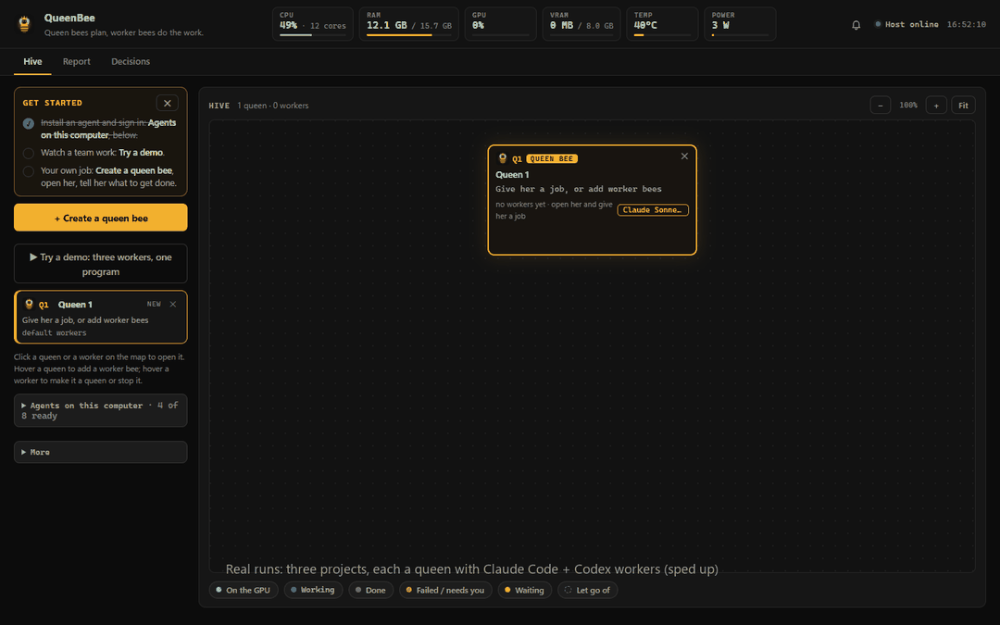

  

<h1 align="center">QueenBee</h1>

<b>Parallel agents are fast. QueenBee makes them finish.</b>

  <a href="https://github.com/QueenBee-SI/QueenBee/releases/latest"><b>Download</b></a> for Windows, macOS and Linux
  &nbsp;·&nbsp; <a href="docs/first-job.md"><b>Run your first job</b></a>
  &nbsp;·&nbsp; <a href="docs/results.md"><b>See the evidence</b></a>

Uses your existing Claude Code and Codex sign-ins. Your code stays on your machine. No QueenBee account.

You already have coding agents. Claude Code in one terminal, Codex in another, each one asking you to approve a
command every few minutes, and you are the person switching between windows to keep them going. QueenBee puts them on
one map, gives them one job, and puts a queen in charge: she splits the work, briefs every worker, answers the routine
prompts by a rule you can read, and runs your test at the end. You can watch every terminal live, type into any of
them, or go and do something else.

## Why people like it

**It finishes the job.** You say what "done" means, usually a test command. When every worker is in, the queen runs
it. If the parts do not meet, she sends one more worker to join them and runs it again. Her report keeps what she
checked apart from what a worker merely said. On our test job, three agents side by side stopped one check short
with every agent saying done; the queen's team ran the check and finished. [The numbers.](docs/results.md) When a
run ends, one click copies its result card (check, prompts, workers, fixes, time, tokens) for a pull request or a post.

**Claude and Codex, one team.** Both work from the same brief on the same job, each on the part that suits it. Any agent
installed on your computer can take any seat, including the queen's.

**You decide who answers the prompts.** Let the queen answer them by her rule: yes inside the project folder, no to
deleting, downloading, installing or writing outside it. Every decision is listed with its reason. Or keep every prompt
for yourself and let her only watch.

**It remembers.** What a team learns about your project stays with the project and goes to the next team. A finding
whose file has changed since is marked as possibly out of date.

**Every agent in one place.** Claude Code, Codex, Gemini CLI, Kimi, OpenCode, Cursor Agent, Mistral Vibe and Grok Build,
each in a real terminal. One glance tells you who is working, who is done and who needs you.

**Your tokens, in view and under a limit.** Every worker's use is counted as it works. Give a queen a budget and a number
of workers at most, and she stops starting new work when she reaches it.

## Get started

1. **Install.** Grab the [latest release](https://github.com/QueenBee-SI/QueenBee/releases/latest): a Windows installer,
   a macOS app or a Linux tarball. Or run it [from source](docs/install.md). You need Claude Code or Codex installed and
   signed in; QueenBee has no account of its own and starts the agents as you.
2. **Try the demo.** One click, and three agents build a small program together on your own account. A few minutes.
   [What to look at while it runs.](docs/free-demo.md)
3. **Give it a real job.** Create a queen, pick a folder, type one sentence with what "done" means:
   *"Add CSV export to the reports page. Done means `pytest tests/` passes."*

The first start on Windows and macOS shows the usual warning for an unsigned program; the [install guide](docs/install.md)
walks through it in two clicks and shows how to check the download's checksum.

## How it works

Every worker is a real agent in a real terminal; click any hexagon on the map and you are inside it. The queen briefs
all of them from the same short brief, looks in when something happens, and settles disagreements on a shared board.
Their permission prompts she answers by one rule, or leaves to you. When everyone is done she runs your check, sends one
more worker if the parts do not meet, and writes a report: what was done, how it was checked, what is not proven.

The [tour of the screen](docs/tour.md) shows each part with a picture. The [user guide](docs/user-guide.md) has every
button, in order.

## What it is not

It does not make agents smarter, and three agents cost about what three agents cost. It is not a sandbox: the rule works
through each agent's own permission system, which is what [SECURITY.md](SECURITY.md) explains. It runs each vendor's own
unmodified program under your own sign-in, never touches a token, and is not affiliated with Anthropic or OpenAI.
Everything stays on your computer. What it does not do yet is listed plainly in [known limits](docs/known-limits.md).

## Documentation

- [Install guide](docs/install.md): Windows, macOS, Linux, from source, and what to do about the first-start warnings.
- [Your first job in five minutes](docs/first-job.md), and [the film](docs/assets/film/queenbee-film.mp4) (1 min 51).
- [Tour of the screen](docs/tour.md): the map, the terminals, the queen's panel, Decisions, Report.
- [User guide](docs/user-guide.md): every button and setting.
- [The demo, step by step](docs/free-demo.md).
- [What we measured](docs/results.md): alone, side by side and with the queen on one job, and the
  [files to run it again](benchmarks/README.md).
- [Known limits](docs/known-limits.md), [Security](SECURITY.md), [Changelog](CHANGELOG.md).

## Contributing

Issues and pull requests are welcome. If something was hard to set up, open an issue and say which step; that is the
most useful report there is. [CONTRIBUTING.md](CONTRIBUTING.md) has the short version of how the code is laid out and how
to run the tests.

## License

QueenBee is free software under the [Apache License 2.0](LICENSE). Use it, change it, ship it; keep the notice.
