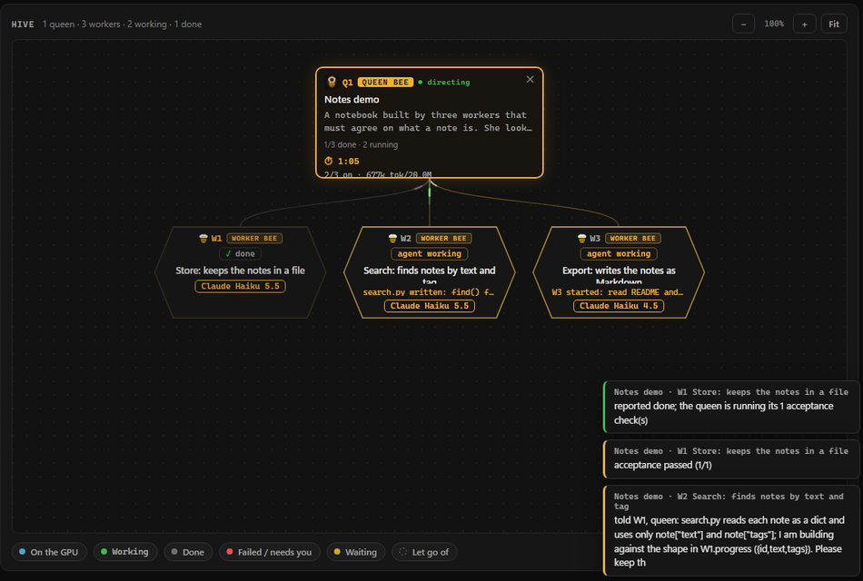
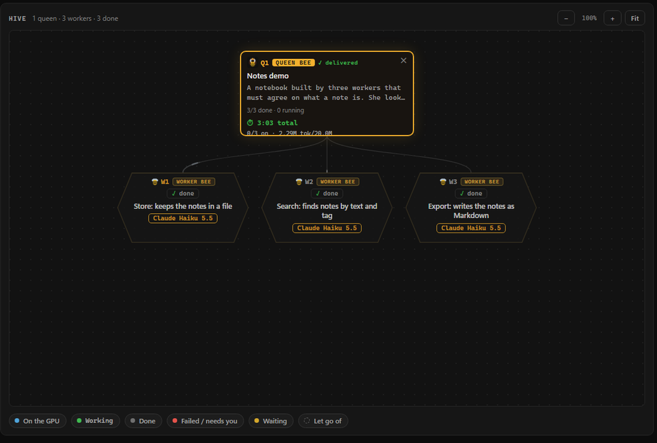
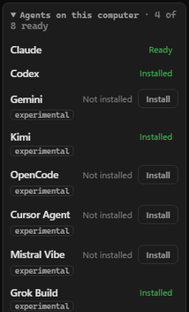

# A tour of the screen

What each part of the QueenBee window does, one picture each. The pictures are from a live demo run (three Haiku workers,
a Sonnet queen, three minutes). Where a picture would show a person's folder path it is left out until it is retaken in
an account made for the purpose.

## One map, every agent live

Each hexagon is one agent. Green is done, orange is working, red needs you. The latest hive-board notes slide in at the
corner. Hover the queen to add a worker; hover a worker to stop it or make it a queen of its own sub-team.

## Click a hexagon: a real terminal

The agent exactly as you would see it in your own terminal, live, with its task above and a box to write to it below. You
can type into it at any time; the queen watches the same terminal. Its model can be switched from the dropdown in the
header.

## The queen's panel

Her agent and model, the project folder, and her last look-in in one line. The job box: type what you want done and what
"done" means, then **Plan and start workers**; or **Start chatting** to talk it through with her first in her own terminal.
Below: the task as you gave it, and the activity stream of the whole hive. Further down: **Limits** (workers at most, a
token budget, memory, CPU, GPU), the **Hive board** with a box to post to all workers or one, and the **Findings** kept
for the next job.

## The Decisions tab

Every permission question the workers asked, with the queen's answer and her reason: approved because it stayed inside the
project folder; refused because it would delete, download, install, or write outside; left to you because the rule did not
settle it. The count on the tab is the number of questions you did not have to answer.

## The Report tab

The queen's completion report, written from the workers' reports and her own checks: what was asked, what was done, how it
was checked, what is not proven or left over, time, cost and the questions that reached you. Under it: the timeline of
when each worker ran, and every file the team changed, with the diff.

## Delivered

The demo at the end: three workers, one program, 3 minutes, 38 permission questions answered by the queen, none by a person.

## Any agent, in any seat

Claude Code (Haiku, Sonnet, Opus), Codex, Gemini CLI, Kimi, OpenCode, Cursor Agent, Mistral Vibe, Grok Build: whatever is
installed appears in every model menu, the queen's too, and you can mix them in one team. The card installs and signs in
what is missing with the vendor's own command, shown before it runs. Claude Code and Codex are the two run every day
here; the others start the same way and may send a question your way.

## Underneath

- **The hive board.** A noticeboard the workers and the queen read between steps: interface decisions, warnings,
  questions. You can post too. The queen looks in whenever something happens there.
- **Memory from one job to the next.** What a team finds out, and what the fix worker had to repair, is kept with the
  project in `.queenbee/FINDINGS.md`; the next team gets the relevant findings in its brief, and a finding whose file has
  changed since is marked as possibly out of date.
- **Branches.** Give each worker its own Git worktree; the queen merges when its checks pass and undoes the merge if the
  whole project's check fails.
- **Free workers.** One agent on the map that belongs to no queen, started the way you would start it, its questions yours.
- **Everything on your computer.** Your accounts, your folders, a local page nobody else can drive. The rule is the
  agent's own permission system run through its hook, not a sandbox: for code you do not trust, use a container.
  [`SECURITY.md`](../SECURITY.md).

Every button, in order: [`user-guide.md`](user-guide.md).
